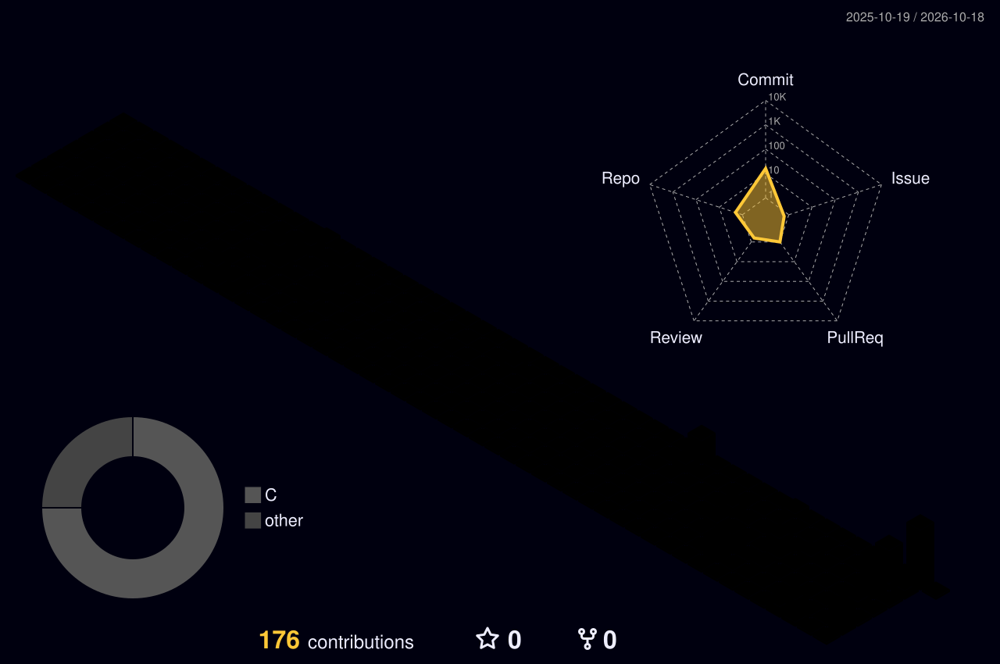

  

### 👋 Olá, sou Walace Oliveira Cardoso!

🎓 **Ciência da Computação — UNIR (Universidade Federal de Rondônia)**

👨‍💻 **Desenvolvedor web** — aplicações completas, do banco de dados à interface

---

---

|  |  |
| --- | --- |

---

  

---

### 📌 Projetos

💼 **LPG&M — Global AI Legal Office** · TypeScript, Next.js, Supabase, Tailwind
Plataforma jurídica internacional: triagem assistida por IA, encaminhamento de casos conforme jurisdição e habilitação, e áreas separadas para cliente, advogado e administração. Monorepo com Turborepo, bilíngue (pt-BR / en-US). Atuo no front-end. *Código fechado.*

🛍️ **LUMEN** · TypeScript
Loja de perfumaria com catálogo e painel administrativo. *Código fechado.*

📱 **tiXQuadros** · Flutter
Clone visual do aplicativo, somente front-end. *Código fechado.*

📊 **[AlgorithmVision](https://github.com/WALACEEE/AlgorithmVision)** · C++
Ferramenta de visualização de algoritmos de ordenação e busca.

☕ **[Projeto final de POO](https://github.com/WALACEEE/projeto-final-poo)** · Java
Sistema de gestão construído como projeto final da disciplina.

---

### 📫 Contato

  

